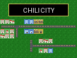

# Chili City

[](https://github.com/chili-chip/chili-city/actions/workflows/build.yml)



A tiny SimCity-like city builder for the [VGC Zero](https://chilichip.eu) handheld, written in C++ with the chili-chip fork of the [32blit SDK](https://github.com/chili-chip/32blit-sdk).

Lay roads, zone land for homes, shops and factories, and watch the city grow month by month while you keep the budget out of the red.

**Goal:** grow your hamlet into a capital. Each rank is reached by population:

| Rank | Population |
|---|---|
| Village | 500 |
| Town | 2000 |
| City | 5000 |
| Capital | 10000 |

Reaching Capital wins the game; you can keep building afterwards. Your rank shows on the stats screen (Y).

## How to play

- The map is 64×64 tiles; the screen shows 16×16 and scrolls when the cursor reaches its edge. A city opens with the cursor in the middle of the map, and blinking arrows on the screen edges show that the map goes on until you scroll for the first time. The cursor pulses so it is easy to find. **MINIMAP** in the pause menu shows the whole city: move the frame with the D-pad and press A to jump there.
- Every new city has its own land: a winding **river**, **lakes** and **forests**, different each time. The middle of the map, where you start, is always clear grass.
  - Nothing can be built on water, but a **road** built on water becomes a **bridge** ($50 a tile). The river also has fords of grass every few tiles. Bulldozing a bridge leaves water.
  - Bulldoze trees ($5) to build where they stand.
  - Trees and water raise the land value next to them, like small parks.
- Zones only grow when they touch a road **and have power**. Unpowered zones blink a yellow bolt.
  - A **power plant** (2×2, placed with the cursor at its top-left corner) powers everything connected to it by **power lines** or by other zones: a zone passes power to the zone next to it. Roads do not carry power.
  - **Residential** grows when there are jobs (the first few homes fill up anyway).
  - **Commercial** grows when there are enough residents to shop.
  - **Industrial** grows when there are enough residents to work, and pollutes the tiles around it: the bigger the factory, the further the smog reaches. Homes in smog stop growing, and in heavy smog they shrink.
  - **Parks** raise land value around them. Homes on high land value grow faster.
  - Press **X** to look at the pollution, land value or crime overlay.
- The **R C I** meter in the bottom-left corner shows demand: a green bar up means the city wants more of that zone, a red bar down means it has too much.
- You start with **$5000**. Building costs money:

  | Tool | Cost |
  |---|---|
  | Road | $10 |
  | Bridge (road on water) | $50 |
  | Residential / Commercial / Industrial zone | $50 |
  | Power line | $5 |
  | Power plant | $1500 |
  | Park | $20 |
  | Fire station | $500 |
  | Police station | $500 |
  | Bulldoze | $5 |

- Every month you collect taxes from residents and businesses and pay upkeep: $1 per road tile, $50 per power plant and $20 per fire or police station.
- Now and then a building **catches fire**. Fire spreads to the buildings next door and burns them down to empty lots. A **fire station** puts out every fire within 6 tiles and makes new ones rarer there. Disasters can be turned off in the pause menu.
- **Crime** grows where homes and shops are crowded together. Homes don't grow in high crime, and crime lowers land value. A **police station** cuts crime to a quarter within 6 tiles.
- The **BUDGET** screen in the pause menu shows last year's taxes and upkeep, and sets the **tax rate** (0–20%, default 7%). Higher taxes bring in more money but lower the demand for every zone; lower taxes do the opposite.
- The game starts on a title screen: **CONTINUE** the saved city, start a **NEW CITY**, or start a new city with the **TUTORIAL**. When a city is saved, NEW CITY and TUTORIAL ask first, because the next save replaces the old city. In the pause menu you can set the speed (paused, normal or fast), open the budget, the minimap or the help, turn disasters or music off, or save and go back to the title.
- You can only build on grass. Bulldoze first to replace something.
- **Tutorial.** The very first launch opens on a start screen that says how long the tutorial takes (6 steps, about a minute) and lets you skip it (B). The tutorial is a box at the top of the screen with one step at a time: scroll the map, build a road, homes, a shop or factory, a power line and a power plant. Each step ends as soon as you have done it. The choice is remembered (save slot 1), so the start screen shows only once; **TUTORIAL** on the title screen plays it again in a new city. **HELP** in the pause menu has the controls and the rules.
- **Saving.** The city saves when you quit the game (Quit to home or holding HOME on the VGC Zero, closing the window on a PC), when you pick SAVE + TITLE, and every January (a game year is 24 seconds at normal speed). Switching the console off is not caught, so the yearly autosave stays. The save keeps the map, money, date, tax rate, fires and where the cursor was; it is offered as **CONTINUE** on the title screen. The web build saves yearly and on SAVE + TITLE.
- **Music.** Two short chiptune loops written for the game, one for the title and one for the city. Turn them off with MUSIC in the pause menu; the choice is remembered.

## Controls

| Action | VGC Zero | PC (SDL build) |
|---|---|---|
| Move cursor (hold to keep moving) | D-pad | Arrow keys or WASD |
| Use tool | A | Z |
| Paint with tool (roads, zones, lines...) | hold A and move | hold Z and move |
| Next tool (tap) | B | X |
| Tool bar: pick any tool, both ways | hold B, then left/right | hold X, then left/right |
| Stats screen | Y | V |
| Overlay: pollution, land value, crime, off | X | C |
| Pause menu (speed, save and quit) | MENU | Esc |

## Building

Clone this repo next to the [32blit-sdk](https://github.com/chili-chip/32blit-sdk) (and, for the console, [pico-sdk](https://github.com/chili-chip/pico-sdk) and [pico-extras](https://github.com/chili-chip/pico-extras)):

```
chilichip/
├── 32blit-sdk/
├── pico-sdk/
├── pico-extras/
└── chili-city/
```

`CMakePresets.json` needs CMake 3.28 or newer. Setup steps for the tools are in the [Linux quickstart](https://chilichip.eu/docs/game-sdk/quickstart/linux-quickstart/).

**PC (Linux SDL):**

```
cmake --preset linux
cmake --build out/build/linux
./out/build/linux/chili-city.elf
```

**VGC Zero (`.blit`, the normal way):**

```
cmake --preset vgc-blit
cmake --build out/build/vgc-blit
```

Plug the console in, copy `out/build/vgc-blit/chili-city.blit` to the **CHILICHIP** drive and eject it. The console installs the game and shows it on the home screen. A newer build replaces the old one and keeps the saved city. See [Installing on the console](https://sdk.chilichip.eu/getting-started/build-console/) for details.

**VGC Zero (standalone `.uf2`, for debugging):**

```
cmake --preset vgc
cmake --build out/build/vgc
```

Hold **BOOT** while plugging the console in, and copy `out/build/vgc/chili-city.uf2` to the `RP2350` drive. This replaces ChiliChip OS: flash `blit-loader.uf2` again afterwards to get the home screen back.

Every push builds the game in CI. The VGC jobs upload `game-blit` and `game-uf2` as workflow artifacts. Each [release](https://github.com/chili-chip/chili-city/releases) has `chili-city.blit` attached.

## Art

All graphics are 8×8 sprites in `assets/tiles.png` (8 sprites per row):

| Sprites | Contents |
|---|---|
| 0 | grass |
| 16–31 | road, picked by which neighbours are roads (north 1, east 2, south 4, west 8) |
| 32–35 | residential, levels 0–3 |
| 36 | police station |
| 40–43 | commercial, levels 0–3 |
| 48–51 | industrial, levels 0–3 |
| 56–71 | power line, picked by which neighbours carry power (same bits as roads) |
| 72–75 | power plant: top-left, top-right, bottom-left, bottom-right quarter |
| 76 | "no power" bolt, drawn over unpowered zones (transparent background) |
| 77 | park |
| 78 | fire station |
| 79 | fire, drawn over burning buildings (transparent background) |

Redraw them in any pixel editor; keep the layout and the game picks them up.

## License

MIT, see [LICENSE](LICENSE). Based on the [32blit boilerplate](https://github.com/32blit/32blit-boilerplate).
