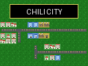

# Chili City




A tiny SimCity-like city builder for the [VGC Zero](https://chilichip.eu) handheld, written in C++ with the chili-chip fork of the [32blit SDK](https://github.com/chili-chip/32blit-sdk).

Lay roads, zone land for homes, shops and factories, and watch the city grow month by month while you keep the budget out of the red.

**Goal:** grow your hamlet into a capital. Each rank is reached by population:

| Rank | Population |
|---|---|
| Village | 500 |
| Town | 2000 |
| City | 5000 |
| Capital | 10000 |

Reaching Capital wins the game; you can keep building afterwards. Your rank shows on the stats screen (Y).

## How to play

- The map is 64×64 tiles; the screen shows 16×16 and scrolls with the cursor. **MINIMAP** in the pause menu shows the whole city: move the frame with the D-pad and press A to jump there.
- Zones only grow when they touch a road **and have power**. Unpowered zones blink a yellow bolt.
  - A **power plant** (2×2, placed with the cursor at its top-left corner) powers everything connected to it by **power lines** or by other zones: a zone passes power to the zone next to it. Roads do not carry power.
  - **Residential** grows when there are jobs (the first few homes fill up anyway).
  - **Commercial** grows when there are enough residents to shop.
  - **Industrial** grows when there are enough residents to work, and pollutes the tiles around it: the bigger the factory, the further the smog reaches. Homes in smog stop growing, and in heavy smog they shrink.
  - **Parks** raise land value around them. Homes on high land value grow faster.
  - Press **X** to look at the pollution, land value or crime overlay.
- The **R C I** meter in the bottom-left corner shows demand: a green bar up means the city wants more of that zone, a red bar down means it has too much.
- You start with **$5000**. Building costs money:

  | Tool | Cost |
  |---|---|
  | Road | $10 |
  | Residential / Commercial / Industrial zone | $50 |
  | Power line | $5 |
  | Power plant | $1500 |
  | Park | $20 |
  | Fire station | $500 |
  | Police station | $500 |
  | Bulldoze | $5 |

- Every month you collect taxes from residents and businesses and pay upkeep: $1 per road tile, $50 per power plant and $20 per fire or police station.
- Now and then a building **catches fire**. Fire spreads to the buildings next door and burns them down to empty lots. A **fire station** puts out every fire within 6 tiles and makes new ones rarer there. Disasters can be turned off in the pause menu.
- **Crime** grows where homes and shops are crowded together. Homes don't grow in high crime, and crime lowers land value. A **police station** cuts crime to a quarter within 6 tiles.
- The **BUDGET** screen in the pause menu shows last year's taxes and upkeep, and sets the **tax rate** (0–20%, default 7%). Higher taxes bring in more money but lower the demand for every zone; lower taxes do the opposite.
- The game starts on a title screen: **CONTINUE** the saved city or start a **NEW CITY**. In the pause menu you can set the speed (paused, normal or fast), open the budget, the minimap or the help, turn disasters off, or save and go back to the title.
- You can only build on grass. Bulldoze first to replace something.
- A new city shows short **hints** at the top of the screen for the first steps (road, homes, power plant, power lines, jobs). **HELP** in the pause menu has the controls and the rules.
- The city autosaves every January (a game year is 24 seconds at normal speed) and is offered as **CONTINUE** on the title screen.

## Controls

| Action | VGC Zero | PC (SDL build) |
|---|---|---|
| Move cursor (hold to keep moving) | D-pad | Arrow keys or WASD |
| Use tool | A | Z |
| Paint with tool (roads, zones, lines...) | hold A and move | hold Z and move |
| Next tool | B | X |
| Stats screen | Y | V |
| Overlay: pollution, land value, crime, off | X | C |
| Pause menu (speed, save and quit) | MENU | Esc |

## Building

Clone this repo next to the [32blit-sdk](https://github.com/chili-chip/32blit-sdk) (and, for the console, [pico-sdk](https://github.com/chili-chip/pico-sdk) and [pico-extras](https://github.com/chili-chip/pico-extras)):

```
chilichip/
├── 32blit-sdk/
├── pico-sdk/
├── pico-extras/
└── chili-city/
```

`CMakePresets.json` needs CMake 3.28 or newer. Setup steps for the tools are in the [Linux quickstart](https://chilichip.eu/docs/game-sdk/quickstart/linux-quickstart/).

**PC (Linux SDL):**

```
cmake --preset linux
cmake --build out/build/linux
./out/build/linux/chili-city.elf
```

**VGC Zero:**

```
cmake --preset vgc
cmake --build out/build/vgc
```

Then hold **BOOT** while plugging the console in, and copy `out/build/vgc/chili-city.uf2` to the `RP2350` drive. The console reboots into the game.

Ready-made `.uf2` files are attached to each [release](https://github.com/chili-chip/chili-city/releases).

## Art

All graphics are 8×8 sprites in `assets/tiles.png` (8 sprites per row):

| Sprites | Contents |
|---|---|
| 0 | grass |
| 16–31 | road, picked by which neighbours are roads (north 1, east 2, south 4, west 8) |
| 32–35 | residential, levels 0–3 |
| 36 | police station |
| 40–43 | commercial, levels 0–3 |
| 48–51 | industrial, levels 0–3 |
| 56–71 | power line, picked by which neighbours carry power (same bits as roads) |
| 72–75 | power plant: top-left, top-right, bottom-left, bottom-right quarter |
| 76 | "no power" bolt, drawn over unpowered zones (transparent background) |
| 77 | park |
| 78 | fire station |
| 79 | fire, drawn over burning buildings (transparent background) |

Redraw them in any pixel editor; keep the layout and the game picks them up.

## License

MIT, see [LICENSE](LICENSE). Based on the [32blit boilerplate](https://github.com/32blit/32blit-boilerplate).
